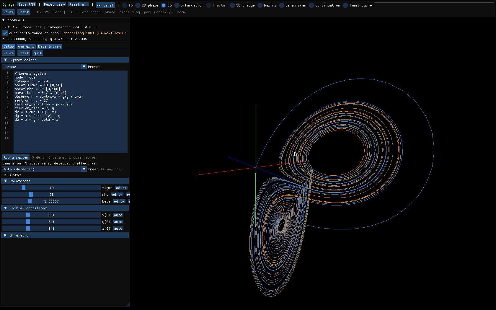

# dynsys

An interactive visualizer and analyzer for dynamical systems — phase portraits,
attractors, basins of attraction, and continuation/bifurcation analysis aimed at
MatCont-style parity — built in C++17 on Dear ImGui + GLFW/OpenGL, with an
optional exact-symbolic (CAS) path.

You describe a system of ODEs or a map in a small `.dyn` text format; dynsys
renders the flow, finds and classifies equilibria, traces limit cycles,
continues bifurcations in one and two parameters, locates and continues codim-2
points, solves homoclinic/heteroclinic connections, and — when the CAS bridge is
available — computes exact eigenvalues and certified derivatives.



## Features

**Phase-space visualization**
- 2-D phase portraits with orbits, nullclines, flow-direction arrows, and a
  speed-colored vector field.
- 3-D attractor view with interactive rotate/pan/zoom.
- Poincaré sections with configurable crossing direction.
- Discrete maps and iterated function systems (IFS) in addition to ODE flows.

**Equilibria & local analysis**
- Automatic equilibrium finding with linear classification (node/saddle/focus/
  center, stability) and stable/unstable manifolds.
- Eigenvalues, Jacobians (finite-difference), determinants.

**Continuation & bifurcations (codim-1)**
- Equilibrium continuation with fold, Hopf, and branch-point detection, plus
  branch switching.
- First Lyapunov coefficient (Hopf criticality); fold and cusp normal forms.

**Codim-2**
- Two-parameter fold and Hopf curves with codim-2 detection: Bogdanov-Takens,
  cusp, generalized-Hopf (Bautin), zero-Hopf (fold-Hopf), and Hopf-Hopf —
  each with its normal-form coefficients.
- Direct codim-2 point location (Bogdanov-Takens), and continuation of the BT,
  zero-Hopf, cusp, and Hopf-Hopf loci as curves in a third parameter.

**Limit cycles**
- Limit-cycle continuation by orthogonal collocation + pseudo-arclength with an
  adaptive mesh, and Floquet multipliers.
- Cycle bifurcation curves: fold-of-cycles (LPC), period-doubling (PD), and
  Neimark-Sacker (NS); branch-point-of-cycles.

**Global connections**
- Homoclinic and heteroclinic orbit solving and continuation, including a
  seed-by-integration helper, a defining-system locator, and a Lin's-method
  path for homoclinic detection.

**Invariants & chaos**
- Lyapunov spectrum and Kaplan-Yorke (Lyapunov) dimension.
- Basins of attraction (single-threaded and parallel/deterministic) and
  fractal/escape-time renders.
- Box-counting (fractal) dimension.

**Exact-symbolic path (optional CAS bridge)**
- When the `lizard` interpreter and the Sangaku CAS are available, eigenvalues,
  equilibria, and derivatives can be computed symbolically; the bridge degrades
  gracefully to the numeric path when they are absent. See the note under
  *Dependencies* — this path is under active development.

**Headless mode**
- A `--headless` runner for batch integration, differential testing, and
  benchmarking without opening a window.

## Build

The Nix flake provides Dear ImGui, GLEW, GLFW, cglm, OpenGL/X libraries,
TPCAS and DSA. Lizard + Sangaku are optional, available through the `cas` shell.
The repository contains no bundled dependency sources.

```sh
nix flake update tpcas # required once your TPCAS migration is pushed
nix develop        # exports IMGUI_DIR, TPCAS_DIR and DSA_ROOT
make               # builds build/dynsys
make test          # parser/IR and numeric smoke suites; no display required
make run
```

Without Nix, install GLFW/GLEW/cglm/OpenGL development packages and `patch`,
then prepare the pinned dependencies separately:

```sh
git clone https://github.com/hydrastro/ds.git ../dsa
git -C ../dsa checkout 909b4a462410b190db2488cb0fac7fca088af81c
make -C ../dsa
git clone https://github.com/hydrastro/tpcas.git ../tpcas
# TPCAS must include the latest DSA migration patch.
git clone --depth 1 --branch v1.92.8 https://github.com/ocornut/imgui.git ../imgui
make MODE=release TPCAS_DIR=../tpcas DSA_ROOT=../dsa IMGUI_DIR=../imgui
make MODE=release test TPCAS_DIR=../tpcas DSA_ROOT=../dsa
```

TPCAS must contain the DSA migration patch supplied earlier. The build copies
its sources into `build/tpcas/` and applies
[`patches/tpcas-numbers.patch`](patches/tpcas-numbers.patch), which adds decimal
and scientific numeric literals required by `.dyn` expressions. Your supplied
checkout is never modified. Unary minus comes from the migrated TPCAS parser.

The committed TPCAS lock still identifies the last published source revision.
After pushing your TPCAS migration, run `nix flake update tpcas` and commit the
refreshed lock. Until then, use your patched checkout via `TPCAS_DIR`, or run
`nix develop --override-input tpcas path:/absolute/path/to/tpcas`.

`DSA_ROOT` accepts a built checkout or installation prefix. Leave it unset to
use `pkg-config dsa`, or set `DSA_CFLAGS` and `DSA_LIBS` explicitly. `DS_ROOT`
is a legacy alias for `DSA_ROOT`. DSA is linked as `libdsa`; its source files
are no longer compiled into dynsys. Start with a clean build when changing
compiler flags or use `BUILD_ROOT=build-asan` / `build-installed` to keep builds
separate. Tests honour `MODE=asan` as well as the normal build modes.

The DSA repository is still named `hydrastro/ds`. After the rename, change the
clone URL and the `dsa-src` input to `github:hydrastro/dsa/<revision>`, then run
`nix flake update dsa-src`. The optional CAS has its own independent dependency
pins and is not migrated by this update.

### Windows cross-build

```sh
nix develop .#windows    # MinGW-w64 cross toolchain + static GLFW/GLEW
make windows             # -> build/windows/dynsys.exe
```

The cross shell builds a separate target DSA archive and runs its Unicode
generator with the native compiler. The two POSIX-only DSA I/O adapters are
excluded from that archive; dynsys does not use them. For a manual cross build,
supply DSA headers and a MinGW-built archive with `DSA_CFLAGS` / `DSA_LIBS`.

## Dependencies

dynsys is built on a small stack of the author's own libraries, sourced through
the flake:

- **[tpcas](https://github.com/hydrastro/tpcas)** — the typed parser used to read
  `.dyn` expressions. It links against **[DSA](https://github.com/hydrastro/ds)**,
  supplied as a separately built static library by the flake.
- **[lizard](https://github.com/hydrastro/lizard)** + **[sangaku](https://github.com/hydrastro/sangaku)**
  — the exact-symbolic (CAS) backend. The `cas_bridge` shells out to the
  `lizard` binary with Sangaku on the module path.

> **Note on lizard / sangaku.** Lizard is under heavy, active development and
> Sangaku depends on it, so the exact-symbolic path may change in radical ways.
> The CAS bridge is intentionally decoupled (dynsys talks to the `lizard` binary
> through a thin bridge and degrades to the numeric path if it is missing or its
> interface shifts), so the core numeric features keep working regardless. Expect
> the CAS surface to evolve.

## Run

```sh
./build/dynsys                                               # interactive GUI
./build/dynsys --headless examples/lorenz.dyn --steps 10000 # headless integration
```

In the GUI the plot fills the window; controls are in the top toolbar and the
left panel. In 2-D phase view: left-click adds an orbit, left-drag pans, the
wheel (or `+`/`-`) zooms, double-click auto-fits. In 3-D view: left-drag
rotates, right-drag pans, the wheel zooms.

## The `.dyn` format

A system is a short text file. Example (`examples/lorenz.dyn`):

```
state x, y, z
mode = ode
integrator = rk4

param sigma = 10 [0,50]
param rho   = 28 [0,100]
param beta  = 8 / 3 [0,10]

plot3d = x, y, z
observe r = sqrt(x*x + y*y + z*z)

section = z - 27
section_direction = positive
section_plot = x, y

initial x = 0.1
initial y = 0
initial z = 0

dx = sigma * (y - x)
dy = x * (rho - z) - y
dz = x * y - beta * z
```

`mode = ode` integrates a continuous vector field (`dx = ...` per state);
`mode = map` iterates a discrete map; `mode = ifs` runs an iterated function
system. Parameters take an optional `[lo,hi]` range used for the sliders and for
continuation. See `examples/` for maps (Hénon, Thomas), oscillators (Van der
Pol), predator-prey (Lotka-Volterra), and higher-dimensional systems.

## Tests

```sh
make test          # parser/IR and full numeric smoke-test suite
make test-cas      # optional CAS test; skips without LIZARD + SANGAKU_ROOT
nix develop .#cas  # shell with the optional CAS dependencies
```

Each analysis feature is validated against analytic ground truth in the suite.

## Scope

dynsys is an independent tool, not a drop-in replacement for MatCont or AUTO. It
validates its analysis features against known-analytic systems, but it does not
claim their decades-long robustness track record. `docs/MATCONT_COMPARISON.md`
states honestly what is at rough parity and what remains.

## Documentation

See `docs/` for the MatCont comparison (`MATCONT_COMPARISON.md`), the CAS bridge
design (`PHASE_E_CAS_BRIDGE.md`), a worked example (`EXAMPLE_FOOD_CHAIN.md`),
the roadmap, and design notes.
